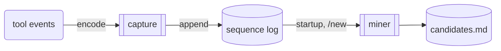
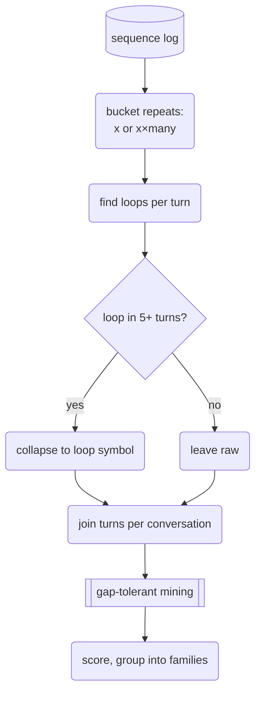
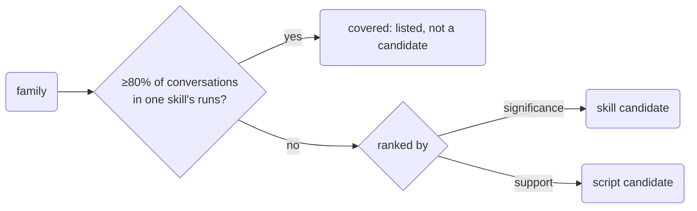

# Workflow miner: build brief

## Limitations

- Every threshold below comes from about two weeks of one user's sessions and was checked against only two skills. Ship it to collect data. Don't trust its rankings yet.
- It finds a skill when the skill's tools rarely appear together outside it. A skill made of common tools used in a disciplined way shows up only once size buckets and `create_file` are in the alphabet, and maybe not at all.
- It names patterns of tool calls, not goals. A person (or, later, a model) still decides what a candidate is for.

## What it does

The harness records a short symbol sequence for every turn and keeps it forever. In the background it mines the whole log for recurring workflows and writes two ranked lists:

- **Skill candidates:** cohesive workflows, ranked by how unlikely they are to be chance.
- **Script candidates:** common chains such as the Go checks, ranked by how many conversations use them.



Transcripts can keep expiring at 300 files. The miner never reads them.

## Conversations

A **conversation** is the unit the miner counts: one harness process's turns, split at each `/new`. Long idle gaps do not split a conversation.

About one transcript file in ten contains a `/new`, so a file is not a conversation. Whether an idle gap should also split one is open; about 3% of user messages came more than an hour after the previous event.

## Capture

A second sink beside the transcript recorder (`recorder.add`, `internal/subagent/transcript.go`) encodes each tool event and appends one line per turn.

| Event | Symbols |
|---|---|
| Any non-bash tool | its name |
| Edit tool with `create` | `create_file` (no path) |
| Other edit/view, `grep`, `glob` | none |
| `start_skill`, `finish_skill`, `fail_run` | none; they set the turn's `skill` field |
| bash | one symbol per command |

Bash is split by a small lexer in `internal/mine/encode.go`. It is separate from the policy lexer in `internal/agent/policy.go`, which refuses anything it can't read; this one skips what it can't read instead.

- Split on `&&`, `;`, `||` and newlines. Keep only the first stage of a pipe.
- Ignore redirects, `$(…)`, heredoc bodies, env prefixes and loop keywords.
- Drop `cd`, `echo`, `export` and read-only verbs (`ls`, `cat`, `sed`, `jq`, `grep`, …).
- `jj`, `go`, `gh` and similar keep their subcommand (`jj_commit`). Everything else keeps its verb only.

Log line, in `~/.local/state/alux/mine/sequences.jsonl`:

```json
{"session":"8c88…","conversation":2,"turn":4,"time":"2026-10-31T10:10Z","skill":"pr-review","calls":["pr_detail","pr_diff","task","task","vault_search"]}
```

`conversation` starts at 0 in each process and goes up by one on each `/new` (`Session.NewSession`). Repeats are stored raw, so bucketing thresholds can change later. Nothing but symbols is stored: no arguments, paths or output. Two weeks of heavy use encodes to about 370 KB (under 30 KB gzipped).

## Miner

Runs in a background goroutine at harness startup and after each `/new`, guarded by a lock file. There is no exit hook: a crash or closed terminal skips one, and the next startup covers every earlier process however it ended. A long-running process is not mined until its next `/new` or restart. Each run starts from scratch over the whole log; the current corpus takes well under a second.



1. **Bucket repeats.** A run of 3+ of one symbol becomes `x×many`, otherwise `x`.
2. **Loops.** A block of 2–5 distinct calls repeated at least 1.5× becomes `loop{…}`, keyed by its smallest rotation, plus `×many` at 3+ rounds. Collapse only loops found in 5+ turns.
3. **Conversations.** Join each conversation's turns into one sequence.
4. **Mine** with PrefixSpan: support 5+ conversations, up to 3 skipped symbols between steps, at most 8 symbols. Keep maximal patterns of 3+ calls.
5. **Score.** Support, lift, and significance: −log₁₀ of the binomial tail, with p the product of each tool's share of conversations.
6. **Families.** Join two patterns when their calls and their conversations both overlap at Jaccard ≥ 0.5. Show each family by its most significant pattern.

## Output



`~/.local/state/alux/mine/candidates.md` holds the two lists. Each entry gives the pattern, conversation count, lift, significance and three example session ids with their conversation numbers. Beneath it, up to three extensions (longer patterns holding the family's top pattern in order) are listed as sub-lines with their conversation count and significance. Covered families go in a third section, for later skill-gap work.

A line in `mine/dismissed.txt` hides a candidate. Candidates are keyed by their symbol sequence, since reruns give no stable ids.

## Parameters

| Parameter | Value | Basis |
|---|---|---|
| Min support | 5 conversations | guess |
| Gap | 3 symbols | guess |
| Max pattern length | 8 symbols | guess |
| `×many` | 3+ rounds | guess |
| Loop collapse | in 5+ turns | probe |
| Covered | ≥80% of conversations in one skill | probe |
| Script vs skill cut | open: what lift separates them? | untested |

## Tests

- **Encoder table.** Bash commands → expected symbols. Goes red if `2>&1` is read as a command `1` again, or if `go build && go test` collapses to one symbol.
- **Conversation split.** A fixture process with a `/new` between two copies of a pattern counts as 2 conversations. Goes red if the counter is not bumped on `/new`.
- **Ranking.** A fixture with one planted cohesive pattern in 5 conversations and one high-count chain in 40. The cohesive one must rank first by significance. Goes red if ranking falls back to support.
- **Covered filter.** Conversations labelled pr-review that hold its workflow land under covered. Goes red if the `skill` field stops being written.

## Not in this build

- One node per reply's parallel batch (needs a reply id on tool events).
- Merging steps whose order doesn't matter.
- A model drafting skills from candidate conversations' goal text.
- Skill-gap mining over covered families.
- Age weighting, and any TUI surface.
